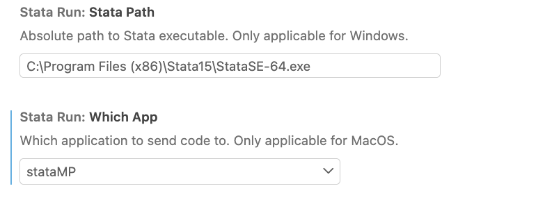
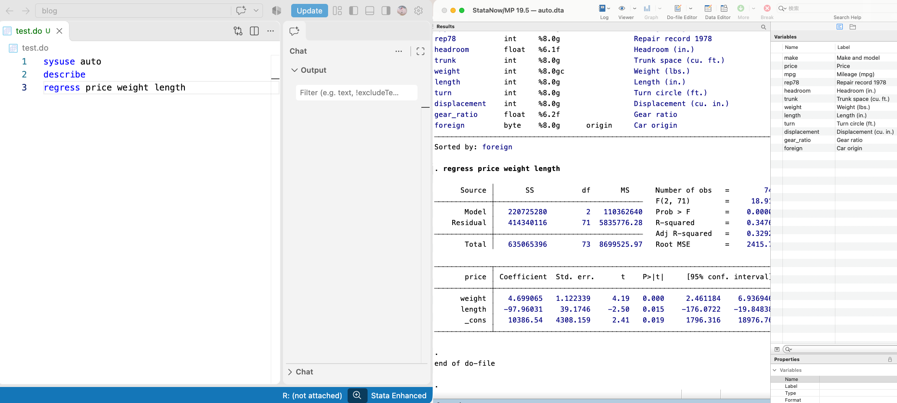
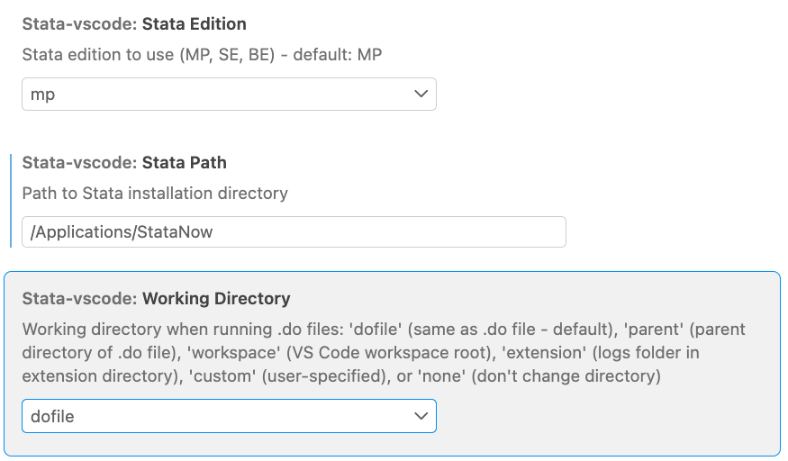
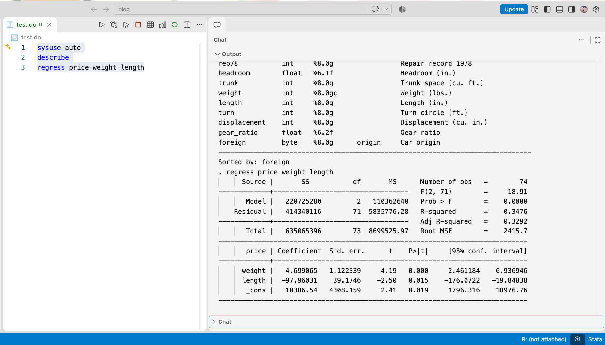

## はじめに

生成AIが毎日のように話題になる昨今である。Stataというold-fashion technologyを使っている自分も生成AIの恩恵に与りたいと思って、一年ほど前にGitHub Copilotを導入した。ただ、自分の身の回りではあまり使っている人を見かけない印象があり、もしかするとあまり方法が知られていないのではないかと感じた。

そこで本記事では、テクノロジー素人（麦山）の目線から、GitHub CopilotでStataのコードを補完するための環境構築の方法について説明する。

なぜGitHub Copilotを使うのか？理由は、コードを書くという作業は自分でコントロールしながら、（自動補完機能の助けを得ることで）より短い時間で、より認知的負荷が少なく、より見やすいコードを書くことができるようになるからである。

以下、順番に説明する。ただし、MacユーザーとWindowsユーザーで少し手順が異なる部分がある。自分はMacユーザーのため、Windowsユーザーの場合の対処についてはあまりわかっていないまま書いている点に注意されたい。

## Visual Studio Codeのインストール

Stataのコードを走らせるときには、do-file editorを使うのが通常である。ただこのdo-file editorはあまり使い勝手がよいとはいえない。また現時点では、Stataのdo-file上で生成AIなどを用いてコードを自動補完したりするといった機能はなさそうである。したがって、別のエディタを使う必要がある。

editorにはいくつか候補があるが、Visual Studio Code（以下VS Code）からStataのdo-fileのコードを実行できることがわかったため、これを使用することにした[^1]。

[^1]: VS Codeに移行する前は、Sublime TextからStataのコードを実行していた。

まずはVS Codeをインストールする。アプリケーションは[VS Codeのページ](https://code.visualstudio.com/)からダウンロードできる。料金やアカウント登録は不要。

VS Code（以下、VS Code）を使ったことがない人向けに、以降の説明で出てくる言葉を整理しておく。

- **アクティビティバー**：画面の左端に縦に並んだアイコンの列。ファイルの一覧（エクスプローラー）、検索、拡張機能などの画面を切り替える。
- **ステータスバー**：画面の最下部の帯。右側には、いま開いているファイルの言語（Stataのコードであれば「Stata」）が表示される。後述するCopilotのアイコンもここに表示される。
- **コマンドパレット**：`Cmd + Shift + P`（Windowsでは `Ctrl + Shift + P`）で開く、コマンドの検索窓。メニューのどこにあるかわからない機能は、ここに名前を入力すると呼び出せる。
- **フォルダを開く**：メニューの「ファイル」→「フォルダーを開く」（英語表示では File → Open Folder）から、do-fileを保存しているフォルダを開く。分析プロジェクトごとにフォルダを作り、それをVS Codeで開いて作業するのが基本の使い方である。

## コードの実行方法

VS Codeを使ってStataのコードを書き、かつ実行するためには、以下の3つの選択肢がある。

1. **stataRun**（Macのみ、Windowsの方法はわからない）：拡張機能であるstataRunを使う。VS Codeは初期状態ではStataのコードの実行やハイライトができないので、Stata用の拡張機能を入れる。なおこの方法はMacユーザーでは比較的簡単にできるようだが、Windowsユーザーではそれなりに複雑な設定がさらに必要なようである。
2. **Stata MCP**（Mac, Windowsどちらも可）：拡張機能であるStata MCPを使う。Stata MCPは、Stataアプリケーションを開くことなく、VS Code上で分析や結果の閲覧を完結させることができる。ただし、Stataウィンドウで使える便利な機能である変数ビューワーがないという欠点がある。
3. **コードはStataから実行**（Mac, Windowsどちらも可）：拡張機能を使わず、VS CodeをStataのコードを書くためだけの場所として使い、コードの実行自体はStata上で行う。

拡張機能をインストールする方法は次のとおりである。

1. アクティビティバーの拡張機能のアイコン（四角形が並んだマーク）をクリックする。`Shift + Cmd + X` でも開ける。
2. 検索欄に拡張機能の名前を入力し、表示された候補から目的のものを選んで「Install（インストール）」をクリックする。
3. もし、すでにインストールした拡張機能をアンインストールしたり、機能しないように設定したりする場合には、拡張機能の画面で対象の拡張機能を選び、「Disable（無効にする）」または「Uninstall（アンインストール）」をクリックする。Disableは、拡張機能を残したまま無効にする設定であり、あとから「Enable（有効にする）」をクリックすれば元に戻せる。Uninstallは、拡張機能そのものを削除する操作である。ボタンの位置や表示は、VS Codeのバージョンによって少し異なる。再起動を求める表示が出た場合は、画面の指示に従う。

### stataRun

まず、**stataRun**を使う方法について説明する。ただしここではMacが前提であり、先ほど説明した通り、**stataRun**はWindowsでは追加の設定が必要となる（ここでは扱わない）。

以下2つの拡張機能をインストールする。

- **stataRun**：VS Code上で書いたコードをStataに送り実行するための拡張機能。
- **Stata Enhanced**：これ自体は入っていなくてもよいが、Stataのコードの色分けなどができるようになり、コードが見やすくなる。

次に、**stataRun**の設定を、自分が使っているStataのエディションに合わせる。**stataRun**のStataエディションの初期設定は StataSE になっており、StataMPなど、他のエディションを使っている場合はエディションを合わせる必要がある。

1.  拡張機能の画面で、stataRunを選ぶ。
2.  「Install / Uninstall」ボタンの横にある歯車のアイコンをクリックし、「settings」を開く。
3.  最下部にあるStata Run: Which Appを、自分のエディション（MP、SE、BEなど）に合わせて変更する。



実際に動くかどうか確認してみよう。VS Codeを開き、新規ファイルを作成し、`test.do` という名前で保存する。そのうえで、たとえば適当なコードを書いて実行してみよう：

``` stata
sysuse auto, clear
describe
```

コードを選択した状態で `Shift + Cmd + S` を押し、Stata側で結果が表示されれば設定は完了である。stataRunのデフォルトでのショートカットキーは次のとおりである。

|  設定画面上の文言 | ショートカット（Mac） | 動作 |
|------------------------|------------------------|------------------------|
| stataRun: Run selection | `Shift + Cmd + S` | 選択した範囲を実行する（選択がなければファイル全体） |
| stataRun: All Lines | `Shift + Cmd + A` | ファイル全体を実行する |
| stataRun: Current line | `Shift + Cmd + C` | カーソルのある行を実行する |
| stataRun: Downward lines | `Shift + Cmd + D` | カーソルのある行からファイルの最後までを実行する |
| stataRun: Frontward lines | `Shift + Cmd + F` | ファイルの最初からカーソルのある行までを実行する |

ショートカットキーを変更することもできる。`Cmd + K` のあとに `Cmd + S` で開くキーボードショートカットの画面で、stataRunのショートカットを別のキーに変更できる。

そのほかの注意点として、ファイルの読み込みや保存で相対パスを使う場合は、VS CodeではなくStata側の作業ディレクトリが基準になる。do-fileの冒頭で `cd` を使って作業ディレクトリを指定するようにしておくと、エラーを避けやすい。



### Stata MCP

別の選択肢として、**Stata MCP**がある。Stata MCPを使うには、Stata 17以上が必要である。また、Pythonのパッケージを管理するUVというツールも必要であるが、拡張機能が初回に自動でインストールを試みる（初回の準備には最大2分ほどかかる）。自動でのインストールがうまくいかない場合は、UVを手動でインストールする必要がある。なお、READMEの前提条件には、PythonやNode.jsは挙げられていない（hanlulong, README）。

まず、先ほどと同様にして、拡張機能**Stata MCP**をインストールする。

もし、ひとつ前の**stataRun**と**Stata Enhanced**を使った方法をすでに試したのであれば、いったんこれらはDisableにしておくとよい。拡張機能の画面で当該機能を選び、Disableにする。

次に、**Stata MCP**の設定を自分が使っているStataのエディションや、アプリケーションの置き場所に合わせる。Stataのインストール先は初期設定では自動で検出されるようだが、正しいかどうか確認しておくとよい。

1. 拡張機能の画面で、Stata MCPを選ぶ。
2.  「Install / Uninstall」ボタンの横にある歯車のアイコンをクリックし、「settings」を開く。
3.  設定画面の「Stata-vscode: Stata Edition」を、自分のエディション（MP、SE、BEなど）に合わせて変更する。初期設定はMPである（設定画面の検索欄に「Stata-vscode」と入力すると、関連する項目が探しやすい）。
4.  設定画面の「Stata-vscode: Stata Path」が、Stataのインストール先を正しく指していることを確認する（画面の例では `/Applications/StataNow`）。



なお、作業ディレクトリ（ファイルの読み込みや保存で相対パスを使うときの基準になる場所）の扱いは、stataRunとは異なる。Stata MCPでは、Stata側の作業ディレクトリではなく、VS Code側の設定が採用される。設定画面の「Stata-vscode: Working Directory」で指定でき、初期設定は「dofile」、つまり実行するdo-fileと同じフォルダである。

VS Codeを開き、新規ファイルを作成し、`test.do` という名前で保存する（すでにやっている場合は必要ない）。そのうえで、たとえば適当なコードを書いて実行してみよう：

``` stata
sysuse auto, clear
describe
```

コードを選択した状態で `Cmd + Shift + Enter` を押し、VS Code側で結果が表示されれば設定は完了である。Stata MCPのデフォルトでのショートカットキーは次のとおりである。

| 動作                   | Mac                   | Windows                |
|------------------------|-----------------------|------------------------|
| 選択範囲を実行する     | `Cmd + Shift + Enter` | `Ctrl + Shift + Enter` |
| ファイル全体を実行する | `Cmd + Shift + D`     | `Ctrl + Shift + D`     |
| 実行を停止する         | `Cmd + Shift + C`     | `Ctrl + Shift + C`     |



エディタの上部に並んでいるアイコンのうち、表のマークのボタンは、**データビューア**（View Data）である。これをクリックすると、現在メモリ上にあるデータセットを、VS Code上で表の形式で確認できる。表示するデータは、Stataの `if` 条件を使って絞り込める（たとえば `price > 5000 & mpg < 30`）。フィルタの欄に条件を入力して「Apply」をクリックすると絞り込みが行われ、「Clear」をクリックすると解除される。

### 拡張機能を使わない方法

上記のような拡張機能を使わず、VS Codeはdo-fileを書いて保存する場所としてだけ使い、実行はStata側で行うという方法もある。具体的には次のような方法である。

1.  VS Codeでdo-fileを編集し、`Cmd + S`（Windowsでは `Ctrl + S`）で保存する。
2.  Stataのコマンドウィンドウで、保存したdo-fileを `do` コマンドで実行する。
3.  結果を確認し、修正が必要であれば1に戻る。

プロジェクトのフォルダの場所を `global` に登録しておくとよい。Macの場合は次のようになる。

``` stata
* プロジェクトフォルダの場所を登録する（ユーザー名やフォルダ名は自分のものに置き換える）
global gh "/Users/ユーザー名/プロジェクトフォルダ"

* VS Codeで保存したdo-fileを実行する
do "${gh}/test.do"
```

なお、Windowsの場合は、パスの区切りに円記号（バックスラッシュ）を使う。

``` stata
global gh "C:\Users\ユーザー名\プロジェクトフォルダ"

do "${gh}\test.do"
```

参考資料：

- 近藤絢子 (2026a). 「ついにAIを本格導入しようと思い立った話 (1)無料版でできるところまで」. *note*, 2026年7月29日. <https://note.com/akondoiss/n/n0caf77e0eb44>.
- 近藤絢子 (2026b). 「ついにAIを本格導入しようと思い立った話 (2) Claude code導入でSTATA回りが劇的に効率upしました」. *note*, 2026年8月22日. <https://note.com/akondoiss/n/ncf161dfbd271>.

## GitHub Copilotとの連携と自動補完

### GitHubへのアカウント登録

GitHub Copilotは、GitHubのアカウントに紐づいたサービスである。GitHubはもともとプログラマーがコードを共有・管理するためのウェブサービスだが、今回の目的では、Copilotを使うための「ログインID」として使うだけであり、Gitやリポジトリの知識は必要ない。

1.  [GitHub](https://github.com/) のページを開き、「Sign up」をクリックする。
2.  メールアドレス、パスワード、ユーザー名を入力する。
3.  画面の指示に従って認証を済ませ、メールに届く確認コードを入力する。

ユーザー名は、あとで変更もできるが、公開される名前になるので、自分の名前のような無難なものにしておくほうがよい。また、セキュリティのため、二要素認証を設定しておくことをすすめる。

### GitHub Copilotのサブスクリプション

GitHub CopilotにはFree, Student, Pro, Pro+, Maxの各種プランがあるが、まずはCopilot Freeで補完機能を試してみるのがよいと思う。そのうえで、この機能が役に立つと思えば、StudentやProへの移行を検討するのがよいだろう。学生であれば無料でGitHub Copilotを使えるらしい：[学生なら無料でGitHub Copilotを使おう！！！](https://zenn.dev/iput_app/articles/77809fa7dd59be)

**Copilot Freeの場合**は、申込の手続きは必要ない。のちほど説明する「VS Codeとの連携」の手順で、VS CodeからGitHubアカウントでサインインすると、プランに未加入のアカウントは自動でCopilot Freeに登録される。Freeだと、補完が月2,000回までといった制限がある。

**有料プラン（Pro, Pro+, Max）に申し込む場合**は、GitHubのCopilotのプラン比較ページから、次の手順で申し込む。

1. GitHubのCopilotのプラン比較ページを開く。
2. 希望するプランの「Get started」をクリックする。
3. 「Subscribe to Copilot Pro」（選んだプランの名前のボタン）をクリックする。
4. 含まれる利用枠を超えて使うかどうかを選び（この設定はいつでも変更できる）、「Save & continue」をクリックする。
5. 請求情報と支払い方法を入力し、内容を確認して「Submit」をクリックする。本人確認のために一時的な承認保留が入ることがあるが、課金ではない。
6. プランの内容を確認し、「Activate Copilot Pro」（選んだプランの名前のボタン）をクリックする。

### VS Codeとの連携

1.  VS Codeの画面下部のステータスバーにあるCopilotのアイコンにカーソルを合わせ、「Use AI Features」を選ぶ。
2.  サインインの方法を選び、表示される指示に従う。ブラウザが開くので、GitHubにログインして、VS Codeからのアクセスを許可する。
3.  設定が完了すると、Copilotが使えるようになる。

別のGitHubアカウントに切り替えたい場合は、アクティビティバーの「Accounts」メニューからサインアウトし、あらためてサインインする。コマンドパレットで「GitHub Copilot: Sign in」を実行する方法もある。

### コードを自動補完してみる

`.do` ファイルを開き、実行したい処理をコメントで書く。たとえば次のようにStataのコメントを書いてみるとする。改行してしばらく待つと、薄い灰色の文字で続きのコードが提案される。`Tab` キーを押すと、その提案を受け入れられる。

``` stata
* auto データを読み込み、foreign ごとに price の平均を表示する
```

繰り返しのある変数を作成しているときなどは、それ以降のコードを自動補完してくれたりする。こちらのほうがむしろより実質的にはメリットを感じやすいと思う。

また、コメントを書いて補完を待つ方法のほかに、Copilotのチャット欄に、やりたいことを文章で書いて依頼することもできる。もちろん、自動補完にせよ、チャットからの提案にせよ、コードが正しいかどうかは自ら検討し、内容を理解したうえで採用すべきであることはいうまでもない。

Copilotを使うと、開いているコードの内容がインターネット経由でAIのサーバーに送られる。個票データの利用規約によっては、外部サービスへのデータ送信が制限される場合がある。したがってdo-fileに個票データの中身（個人を特定できる値など）を書き込まないことはもちろん、所属機関や調査データの利用規約も確認しておくとよい。この点はこれまで以上に注意すべき点であるといえる。
